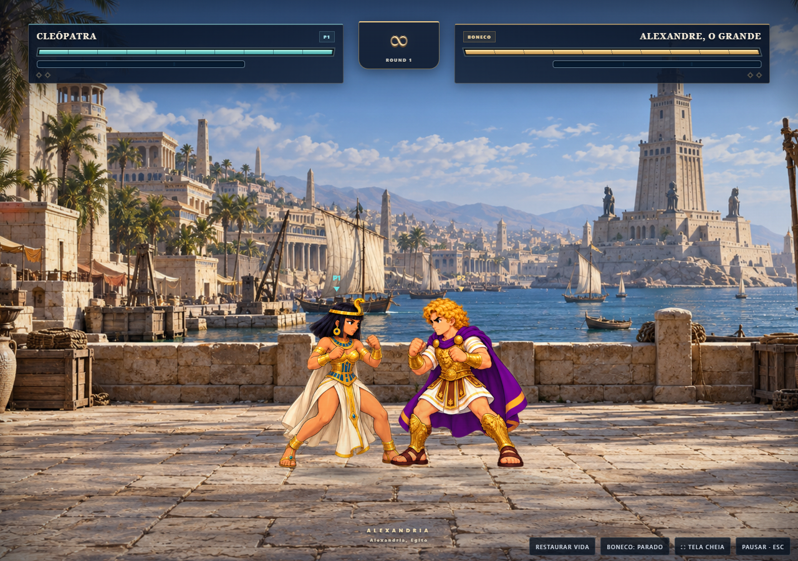

# Cronos Fighter

**Jogo de luta para navegador · Desenvolvimento integral por Felipe Landgraf**

Um encontro entre personagens de diferentes períodos da História em uma arena de combate. O Cronos Fighter integra o projeto educacional [Cronos](https://joguecronos.com.br).

**[Jogar a versão publicada](https://joguecronos.com.br/#minigames/cronos-fighters)**



## Autoria e atuação

Sou **[Felipe Landgraf](https://github.com/Felipe-Landgraf)**, responsável pelo desenvolvimento completo do Cronos Fighter: lógica de combate, interface, animações e integração dos recursos audiovisuais. O jogo utiliza também recursos de terceiros, cujas atribuições e licenças foram preservadas.

## Destaques

- 24 personagens históricos, distribuídos por seis períodos.
- Partidas contra o computador e modo local para dois jogadores.
- Socos, chutes, rasteiras, defesa e ataques especiais.
- Animações de movimentação e combate.
- Efeitos visuais, áudio e locução.
- Suporte a teclado, toque e gamepad.

## Tecnologias

JavaScript, HTML, CSS, Canvas API, Web Audio API e Gamepad API.

## Executar localmente

Requer Node.js 18 ou superior. Na pasta do projeto, execute:

```sh
npm start
```

Abra **http://127.0.0.1:4173** no navegador. Não é necessário instalar dependências. Use um servidor HTTP para carregar corretamente os módulos e recursos do jogo.

## Estrutura

```text
index.html             Jogo e interface da distribuição publicada
media/                 Imagens, animações e fonte
polish/                Efeitos, áudio, manifesto e créditos
polish/licenses/       Licenças dos recursos de terceiros
tools/serve.mjs         Servidor local sem dependências
VERSION.json           Identificação e origem da versão
checksums.sha256       Verificação de integridade dos arquivos recuperados
```

## Versão

Este repositório preserva a **V34 — Caminhada aprovada com as melhorias audiovisuais integradas ao Cronos**, conferida em **5 de novembro de 2026**. A identificação interna continua sendo `V34-CAMINHADA-APROVADA`.

A pasta do Fighter foi comparada com o ZIP do [repositório Cronos da equipe](https://github.com/tiagodk/cronos) fornecido por Felipe. Os 222 arquivos do jogo já recuperados do site coincidem byte a byte com o repositório; o manifesto original de recursos também foi incluído. Estão preservados os efeitos dos especiais, áudio, locução, otimizações e licenças dessa versão.

O código de distribuição e seus recursos foram preservados. A documentação e o servidor local foram acrescentados para facilitar a apresentação e a execução do projeto. Os quatro arquivos de teste do Fighter foram trazidos do repositório da equipe, ajustando apenas os caminhos para esta distribuição independente.

## Verificação

Execute `npm test` para verificar os recursos, as licenças, o áudio, o ciclo de pausa e os efeitos visuais. **61 testes aprovados** na preparação desta entrega. Essa verificação usa Node.js e não substitui uma partida em dispositivo físico.

Os documentos em `docs/` preservam o histórico das melhorias da equipe; os resultados antigos ali descritos são registros da entrega original.

## Créditos e licenças

Consulte [os créditos completos](polish/credits.html), o [manifesto dos recursos](polish/manifest.json), as [licenças originais](polish/licenses/) e a [licença da fonte](FONT-LICENSE.txt).

A autoria do desenvolvimento do jogo não substitui a autoria dos recursos de terceiros. As licenças específicas desses recursos permanecem aplicáveis; este repositório não atribui uma nova licença geral a eles.
